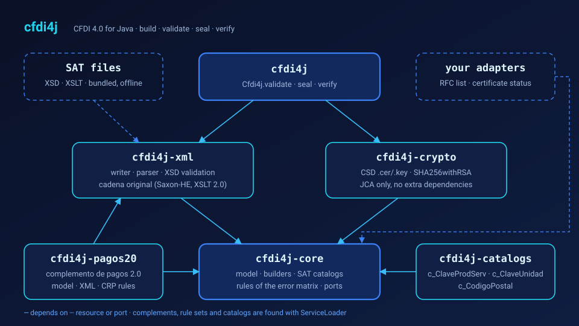

[English](README.md) · **Español**

# cfdi4j

[](https://github.com/alktrip/cfdi4j/actions/workflows/ci.yml)
[](LICENSE)


Crea, valida, sella y verifica comprobantes fiscales digitales (**CFDI 4.0**) en Java.

Para emitir un CFDI correcto hay que cumplir:
- los esquemas XSD del SAT y sus catálogos;
- la transformación XSLT 2.0 que produce la cadena original;
- la firma RSA con el certificado de sello digital (CSD) del emisor;
- unas 130 reglas de negocio de la matriz de errores oficial.

cfdi4j reúne todo eso en una API pequeña y tipada. Cada regla indica el documento público del
SAT del que proviene.

- **Modelo tipado y constructores** que calculan importes, totales e impuestos con el redondeo
  oficial y nunca sobrescriben un valor que tú indiques.
- **Validación** contra los esquemas del SAT incluidos y las reglas de la matriz de errores, con
  códigos estables (`CFDI40xxx`, `CRP20xxx`).
- **Sellado y verificación** con los archivos `.cer` y `.key` del CSD, solo con el JDK (JCA).
- **Sin red**: los XSD y XSLT oficiales vienen incluidos sin modificar y se resuelven localmente.
  La biblioteca nunca hace llamadas de red.
- Modela el **complemento de pagos 2.0** y el TimbreFiscalDigital 1.1. Los demás complementos se
  conservan como XML.

## Inicio rápido

Requiere Java 21 o posterior. Estas son las coordenadas de la primera versión, `0.1.0`, en cuanto
se publique en Maven Central:

```xml
<dependency>
  <groupId>io.github.alktrip</groupId>
  <artifactId>cfdi4j</artifactId>
  <version>0.1.0</version>
</dependency>
```

El ejemplo usa el CSD público de pruebas del SAT de `EKU9003173C9` (contraseña `12345678a`). Viene
en este repositorio, en [`specs/sat/csd-pruebas/EKU9003173C9`](specs/sat/csd-pruebas/EKU9003173C9),
y `dir` es esa carpeta.

<!-- quickstart -->
```java
Csd csd = Csd.load(dir.resolve("csd.cer"), dir.resolve("csd.key"), "12345678a".toCharArray());
Comprobante cfdi = Comprobante.builder().fecha(LocalDateTime.of(2026, 11, 14, 10, 30)).lugarExpedicion("72000")
    .tipoDeComprobante(TipoDeComprobante.INGRESO).exportacion(Exportacion.NO_APLICA).moneda(Moneda.MXN)
    .formaPago(FormaPago.TRANSFERENCIA).metodoPago(MetodoPago.PUE)
    .emisor(e -> e.rfc("EKU9003173C9").nombre("ESCUELA KEMPER URGATE").regimenFiscal(RegimenFiscal.GENERAL_PM))
    .receptor(r -> r.rfc("XIA190128J61").nombre("XENON INDUSTRIAL ARTICLES").domicilioFiscalReceptor("76343")
        .regimenFiscalReceptor(RegimenFiscal.GENERAL_PM).usoCFDI(UsoCFDI.GASTOS_EN_GENERAL))
    .concepto(c -> c.claveProdServ("01010101").cantidad("1").claveUnidad("ACT").descripcion("Servicio")
        .valorUnitario("100.00").objetoImp(ObjetoImp.SI_OBJETO).trasladoIva16())
    .build();

ValidationResult result = Cfdi4j.validate(cfdi);        // business rules + XSD
String xml = Cfdi4j.seal(cfdi, csd).toXml();             // cadena original + SHA256withRSA
boolean intact = Cfdi4j.verify(xml).isValid();           // not altered since it was sealed
```

El constructor calcula `SubTotal`, `Total`, el `Importe` del concepto y todos los impuestos.

Se omiten los imports; el programa completo es [`QuickStart.java`](cfdi4j-examples/src/main/java/io/github/alktrip/cfdi4j/examples/QuickStart.java),
y una prueba comprueba que este fragmento es exactamente el código que ejecuta. Hay más ejemplos:
- [un recibo de pago](cfdi4j-examples/src/main/java/io/github/alktrip/cfdi4j/examples/ReciboDePago.java);
- [revisar un archivo XML](cfdi4j-examples/src/main/java/io/github/alktrip/cfdi4j/examples/ValidarXml.java).

Cada violación tiene un código, una severidad, una ubicación (XPath) y un mensaje en español:

```java
for (Violation v : result.violations()) {
    System.out.println(v.code() + " " + v.location() + ": " + v.message());
}
```

## Funcionalidad

| Funcionalidad | Estado |
|---|---|
| Modelo y constructor de CFDI 4.0, con importes, totales e impuestos calculados | ✅ soportado |
| Catálogos del SAT como constantes tipadas (c_FormaPago, c_UsoCFDI, c_RegimenFiscal y 12 más) | ✅ soportado |
| c_ClaveProdServ, c_ClaveUnidad y c_CodigoPostal (módulo opcional `cfdi4j-catalogs`) | ✅ soportado |
| Escritura y lectura de XML; validación XSD con los esquemas del SAT incluidos | ✅ soportado |
| Cadena original con el XSLT 2.0 oficial (Saxon-HE), sin red | ✅ soportado |
| Sellado con el `.cer` y `.key` del CSD (SHA256withRSA); verificación de que un CFDI no fue alterado | ✅ soportado |
| Reglas del certificado: RFC del emisor, CSD y no e.firma, vigencia en `Fecha`, revocación mediante un puerto | ✅ soportado |
| Certificado emitido por una autoridad certificadora del SAT (certificados de las autoridades del SAT incluidos) | ✅ soportado |
| Verificación del TimbreFiscalDigital 1.1 (SelloSAT) con el certificado del SAT que timbró | ✅ soportado |
| Reglas de la matriz de errores CFDI 4.0: 101 implementadas y 10 parciales ([reporte](docs/rules-coverage.md)) | ✅ soportado |
| Complemento de pagos 2.0: modelo, constructor, XML y su matriz de errores ([reporte](docs/rules-coverage-pagos20.md)) | ✅ soportado |
| Validaciones que requieren datos del SAT (lista de RFC, revocación de certificados) mediante tus adaptadores | 🔌 puertos |
| Otros complementos (Nómina, Carta Porte, Comercio Exterior…) | 📋 planeado; hoy se conservan como XML |
| Timbrado y cancelación con un PAC | ❌ fuera del alcance |

## Arquitectura



| Módulo | Contenido |
|---|---|
| `cfdi4j-core` | Modelo, constructores, catálogos, reglas de validación y puertos. Sin XML ni E/S: se puede usar solo. |
| `cfdi4j-xml` | Escritura, lectura, validación XSD y cadena original. Depende de Saxon-HE. |
| `cfdi4j-crypto` | Carga del CSD, firma y verificación del sello, solo con el JDK. |
| `cfdi4j-pagos20` | Complemento de pagos 2.0. |
| `cfdi4j-catalogs` | Los tres catálogos grandes. Basta agregarlo al class path o module path y el validador lo encuentra. |
| `cfdi4j` | La fachada `Cfdi4j` y `CfdiEngine` para configurar el reloj, el idioma y los puertos. |
| `cfdi4j-bom` | BOM para alinear las versiones. |

Cada módulo es un módulo JPMS (`io.github.alktrip.cfdi4j.*`) y también funciona en el class path.
Las decisiones de diseño están en [`docs/adr`](docs/adr).

### Reglas que requieren datos del SAT

Algunas reglas necesitan información que solo tiene el SAT, como la lista de RFC inscritos o si un
certificado fue revocado. cfdi4j nunca las da por buenas en silencio: sin una implementación de
`TaxpayerRegistry` o `CertificateStatusProvider`, las reporta como advertencia **no verificada**.

```java
CfdiEngine engine = Cfdi4j.configure()
    .certificateAuthorities(SatAuthorities.production())   // el SAT emitió el certificado
    .taxpayerRegistry(rfc -> miServicioRfc.buscar(rfc))
    .certificateStatusProvider((serie, momento) -> miClienteOcsp.estado(serie, momento))
    .build();
```

## Fuentes oficiales

cfdi4j solo sigue documentos públicos del SAT. Cada uno aparece en
[`specs/SOURCES.md`](specs/SOURCES.md) con su URL, versión, fecha de publicación y SHA-256. Los
principales son:

- El Anexo 20 y su Guía de llenado (CFDI 4.0).
- Los esquemas XSD y el XSLT de la cadena original, incluidos sin modificar.
- El archivo de catálogos `catCFDI_V_4_20261106.xls`, del que se genera el código de los catálogos.
- La matriz de errores de CFDI 4.0 (2026-03-25) y la del complemento de pagos 2.0 (revisión B).
- El estándar y la Guía de llenado del complemento de pagos 2.0.
- Los certificados públicos de prueba (`Certificados_de_Prueba.zip`).

Cuando un documento es ambiguo, la interpretación queda registrada en un ADR. Por ejemplo, el
redondeo de pagos 2.0 está en el [ADR 0011](docs/adr/0011-pagos20-arithmetic.md).

## Cómo se prueba

- Un caso válido y al menos uno inválido por cada regla, y una prueba que falla si alguna regla no
  tiene caso.
- Golden files cuya cadena original y sello esperados se generan **sin cfdi4j**: la línea de
  comandos de Saxon con el XSLT descargado del SAT y `openssl dgst -sha256 -sign`.
- Vectores de terceros, descargados y verificados por hash en un perfil opcional. La cadena
  original de 35 ejemplos de CryptoSys coincide byte por byte, y un documento sellado por
  CfdiUtils se verifica.
- Pruebas basadas en propiedades (jqwik) para importes, redondeo y totales.
- Ida y vuelta (construir → XML → leer → igual).
- Pruebas de alteración: cambiar un solo atributo invalida el sello.
- Compilación en JDK 21 y 25, con Error Prone y una cobertura mínima de 90 % con JaCoCo.

## Limitaciones

- **No es un PAC.** cfdi4j no timbra ni cancela comprobantes. Un CFDI sellado se debe enviar a un
  PAC autorizado.
- Por defecto, `verify` comprueba la **integridad**: que el sello corresponda al contenido y al
  certificado que viene dentro del documento.
  - Para comprobar además que ese certificado lo emitió el SAT, configura las autoridades del SAT;
    si no, esa revisión se reporta como no verificada:
    `Cfdi4j.configure().certificateAuthorities(SatAuthorities.production()).build()`.
  - `validate` agrega las reglas del certificado: RFC, CSD, vigencia y, con un
    `CertificateStatusProvider`, revocación.
- `validate(byte[])` y `verify` no leen documentos de más de 20 MiB por defecto
  (`maxDocumentSize`).
- Las reglas que requieren datos del SAT dependen de los adaptadores que proporciones. Sin ellos se
  reportan como no verificadas.
- Solo pagos 2.0 y el TimbreFiscalDigital se modelan y se validan contra su XSD. Los demás
  complementos se escriben y se leen sin cambios, y su esquema se reporta como no verificado
  (`CFDI4J-002`).
- Los mensajes de error del XSD vienen del analizador del JDK y están en inglés.
- No soporta CFDI 3.3 ni versiones anteriores.
- El SAT actualiza sus catálogos y matrices; cada versión indica los archivos de los que se generó.

## Contribuir

Las issues y los pull requests son bienvenidos. Lee [CONTRIBUTING.md](CONTRIBUTING.md); toda regla
debe citar la fuente pública del SAT que implementa. Consulta también la
[hoja de ruta](ROADMAP.md), el [registro de cambios](CHANGELOG.md) y la
[política de seguridad](SECURITY.md).

## Licencia

[Apache License 2.0](LICENSE). Los archivos del SAT se redistribuyen sin modificar; ver
[NOTICE](NOTICE).
