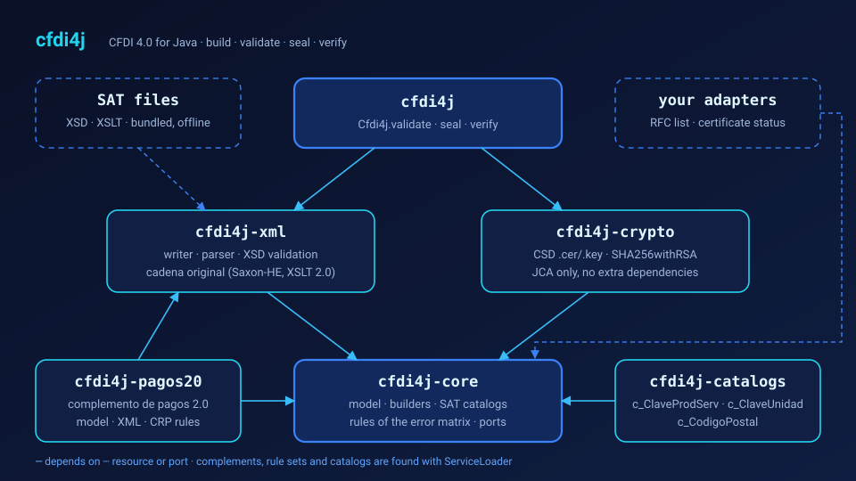

**English** · [Español](README.es.md)

# cfdi4j

[](https://github.com/alktrip/cfdi4j/actions/workflows/ci.yml)
[](LICENSE)


Create, validate, seal and verify Mexican electronic invoices (**CFDI 4.0**) in Java.

A CFDI is the XML invoice that every business in Mexico must issue. Getting one right means
following the SAT's XSD schemas, its catalogs, an XSLT 2.0 transformation that produces the
*cadena original*, an RSA signature with the issuer's certificate (CSD), and about 130 business
rules of the official error matrix. cfdi4j puts all of that behind one small, typed API, with
every rule traced to the public SAT document it comes from.

- **Typed model and builders** that derive the arithmetic (importes, totals, taxes) with the
  official rounding and never overwrite a value you set.
- **Validation** against the bundled SAT schemas and the business rules of the error matrix,
  with stable error codes (`CFDI40xxx`, `CRP20xxx`).
- **Sealing and verification** with the CSD `.cer`/`.key` files, using only the JDK (JCA).
- **Offline by design**: the official XSD and XSLT files are bundled unmodified and resolved
  locally. The library never makes network calls.
- **Complemento de pagos 2.0** and the TimbreFiscalDigital 1.1 are modeled; other complements
  are kept as XML.

## Quick start

Requires Java 21 or later. The coordinates below are those of the first release, `0.1.0`, once it
is published to Maven Central:

```xml
<dependency>
  <groupId>io.github.alktrip</groupId>
  <artifactId>cfdi4j</artifactId>
  <version>0.1.0</version>
</dependency>
```

The example uses the SAT public test CSD of `EKU9003173C9` (password `12345678a`), which ships with
this repository in [`specs/sat/csd-pruebas/EKU9003173C9`](specs/sat/csd-pruebas/EKU9003173C9);
`dir` is that directory.

<!-- quickstart -->
```java
Csd csd = Csd.load(dir.resolve("csd.cer"), dir.resolve("csd.key"), "12345678a".toCharArray());
Comprobante cfdi = Comprobante.builder().fecha(LocalDateTime.of(2026, 11, 14, 10, 30)).lugarExpedicion("72000")
    .tipoDeComprobante(TipoDeComprobante.INGRESO).exportacion(Exportacion.NO_APLICA).moneda(Moneda.MXN)
    .formaPago(FormaPago.TRANSFERENCIA).metodoPago(MetodoPago.PUE)
    .emisor(e -> e.rfc("EKU9003173C9").nombre("ESCUELA KEMPER URGATE").regimenFiscal(RegimenFiscal.GENERAL_PM))
    .receptor(r -> r.rfc("XIA190128J61").nombre("XENON INDUSTRIAL ARTICLES").domicilioFiscalReceptor("76343")
        .regimenFiscalReceptor(RegimenFiscal.GENERAL_PM).usoCFDI(UsoCFDI.GASTOS_EN_GENERAL))
    .concepto(c -> c.claveProdServ("01010101").cantidad("1").claveUnidad("ACT").descripcion("Servicio")
        .valorUnitario("100.00").objetoImp(ObjetoImp.SI_OBJETO).trasladoIva16())
    .build();

ValidationResult result = Cfdi4j.validate(cfdi);        // business rules + XSD
String xml = Cfdi4j.seal(cfdi, csd).toXml();             // cadena original + SHA256withRSA
boolean intact = Cfdi4j.verify(xml).isValid();           // seal and certificate check
```

`SubTotal`, `Total`, the concept's `Importe` and every tax amount are derived by the builder.
Imports are omitted; the full program is [`QuickStart.java`](cfdi4j-examples/src/main/java/io/github/alktrip/cfdi4j/examples/QuickStart.java);
a test checks that this snippet is exactly the code it runs. More examples:
[a recibo de pago](cfdi4j-examples/src/main/java/io/github/alktrip/cfdi4j/examples/ReciboDePago.java)
and [checking an XML file](cfdi4j-examples/src/main/java/io/github/alktrip/cfdi4j/examples/ValidarXml.java).

Each violation has a code, a severity, a location (an XPath) and a message:

```java
for (Violation v : result.violations()) {
    System.out.println(v.code() + " " + v.location() + ": " + v.message());
}
```

## Features

| Feature | Status |
|---|---|
| CFDI 4.0 model and builder, with derived importes, totals and taxes | ✅ supported |
| SAT catalogs as typed constants (c_FormaPago, c_UsoCFDI, c_RegimenFiscal and 12 more) | ✅ supported |
| c_ClaveProdServ, c_ClaveUnidad and c_CodigoPostal (optional module `cfdi4j-catalogs`) | ✅ supported |
| XML writing and parsing; XSD validation with the bundled SAT schemas | ✅ supported |
| Cadena original with the official XSLT 2.0 (Saxon-HE), offline | ✅ supported |
| Sealing with the CSD `.cer`/`.key` (SHA256withRSA); seal and certificate verification | ✅ supported |
| Verification of the TimbreFiscalDigital 1.1 (SelloSAT) with the SAT certificate that stamped it | ✅ supported |
| Business rules of the CFDI 4.0 error matrix: 101 implemented, 10 partial ([report](docs/rules-coverage.md)) | ✅ supported |
| Complemento de pagos 2.0: model, builder, XML and its error matrix ([report](docs/rules-coverage-pagos20.md)) | ✅ supported |
| Checks that need SAT data (RFC list, certificate revocation) through your own adapters | 🔌 ports |
| Other complements (Nómina, Carta Porte, Comercio Exterior…) | 📋 planned, kept as XML today |
| Stamping (timbrado) and cancellation with a PAC | ❌ out of scope |

## Architecture



| Module | Contents |
|---|---|
| `cfdi4j-core` | Model, builders, catalogs, validation rules and ports. No XML and no I/O: it can be used alone. |
| `cfdi4j-xml` | Writer, parser, XSD validation and cadena original. Depends on Saxon-HE. |
| `cfdi4j-crypto` | CSD loading, signing and seal verification, with the JDK only. |
| `cfdi4j-pagos20` | Complemento de pagos 2.0. |
| `cfdi4j-catalogs` | The three large catalogs. Add it to the class or module path and the validator finds it. |
| `cfdi4j` | The facade `Cfdi4j`, plus `CfdiEngine` for configuration (clock, locale, ports). |
| `cfdi4j-bom` | Bill of materials to align the versions. |

Every module is a JPMS module (`io.github.alktrip.cfdi4j.*`) and also works on the class path. The
design decisions are recorded in [`docs/adr`](docs/adr).

### Rules that need SAT data

Some rules need information that only the SAT has, such as the list of registered RFCs or whether
a certificate was revoked. cfdi4j never passes them silently. They report a *not verified*
warning unless you plug in an implementation of `TaxpayerRegistry` or `CertificateStatusProvider`:

```java
CfdiEngine engine = Cfdi4j.configure()
    .taxpayerRegistry(rfc -> myRfcService.find(rfc))
    .certificateStatusProvider((serial, at) -> myOcspClient.status(serial, at))
    .build();
```

## Official sources

cfdi4j follows only public SAT documents. Each one is listed with its URL, version, publication
date and SHA-256 in [`specs/SOURCES.md`](specs/SOURCES.md). The main ones are:

- Anexo 20 and its Guía de llenado (CFDI 4.0).
- The XSD schemas and the XSLT of the cadena original, bundled unmodified.
- The catalog file `catCFDI_V_4_20261106.xls`, from which the catalog code is generated.
- The CFDI 4.0 error matrix (2026-03-25) and the Pagos 2.0 error matrix (revision B).
- The standard and the Guía de llenado of the complemento de pagos 2.0.
- The public test certificates (`Certificados_de_Prueba.zip`).

When a document is ambiguous, the interpretation is recorded in an ADR. For example, the rounding
of Pagos 2.0 is in [ADR 0011](docs/adr/0011-pagos20-arithmetic.md).

## How it is tested

- One valid and at least one invalid case for every rule, and a test that fails if a rule has
  none.
- Golden files whose expected cadena original and seal are produced **without cfdi4j**: Saxon's
  command line with the XSLT downloaded from the SAT, and `openssl dgst -sha256 -sign`.
- Third-party vectors, downloaded and hash-checked in an optional profile. The cadena original of
  35 CryptoSys examples matches byte for byte, and a document sealed by CfdiUtils verifies.
- Property-based tests (jqwik) for amounts, rounding and totals.
- Round trips (build → XML → parse → equal) and tampering tests (one changed attribute breaks
  the seal).
- Builds on JDK 21 and 25, with Error Prone and a JaCoCo coverage minimum of 90 %.

## Limitations

- **Not a PAC.** cfdi4j does not stamp (timbrar) or cancel invoices. A sealed CFDI must still be
  sent to an authorized PAC.
- Rules that need SAT data are only as good as the adapters you provide. Without them, they are
  reported as not verified.
- Only Pagos 2.0 and the TimbreFiscalDigital are modeled and validated against their XSD. Other
  complements are written and read back unchanged, and their schema is reported as not verified
  (`CFDI4J-002`).
- XSD error messages come from the JDK's parser and are in English.
- CFDI 3.3 and earlier versions are not supported.
- The SAT updates its catalogs and matrices. Each release names the files it was generated from.

## Contributing

Issues and pull requests are welcome. Please read [CONTRIBUTING.md](CONTRIBUTING.md); every rule
must cite the public SAT source it implements. See also the [roadmap](ROADMAP.md), the
[changelog](CHANGELOG.md) and the [security policy](SECURITY.md).

## License

[Apache License 2.0](LICENSE). The bundled SAT files are redistributed unmodified; see
[NOTICE](NOTICE).
